  

    
  

   

  

    
  

   

  

    
    
    
    
  

   
  
  
  
   

  
💻 Tech Stack

  
  

    <i>Languages & Scripting</i> 
    
    
    
    
    
    
    
    
  

  

    <i>Security & OS</i> 
    
    
    
  

  

    <i>Cloud & DevOps</i> 
    
    
    
    
    
    
  

  

    <i>Frameworks & Databases</i> 
    
    
    
    
    
  

  

    <i>Tools & Hardware</i> 
    
    
    
    
    
    
  

   
  
  
  
   

  
📊 GitHub Analytics

  
  

    
    
  

  
  

    
  

   

  
🎮 Contribution Arcade

  

    <picture>
      <source media="(prefers-color-scheme: dark)" srcset="https://raw.githubusercontent.com/Fly3417/Fly3417/pacman-output/pacman-contribution-graph-dark.svg">
      <source media="(prefers-color-scheme: light)" srcset="https://raw.githubusercontent.com/Fly3417/Fly3417/pacman-output/pacman-contribution-graph.svg">
      
    </picture>
  

   
  
  
⏱️ Productive Time

  

    
  

   

  
🎧 Favorite Track

  

    </a>
  

   

  
👤 About Me

  

    
    
    
    
  

  
  

    <i>Building lightweight security automation tools (Node.js & Python) for Termux/Linux.</i>
  

   
  
  

    > "Build to understand. Break to secure. Automate to scale."_
  

